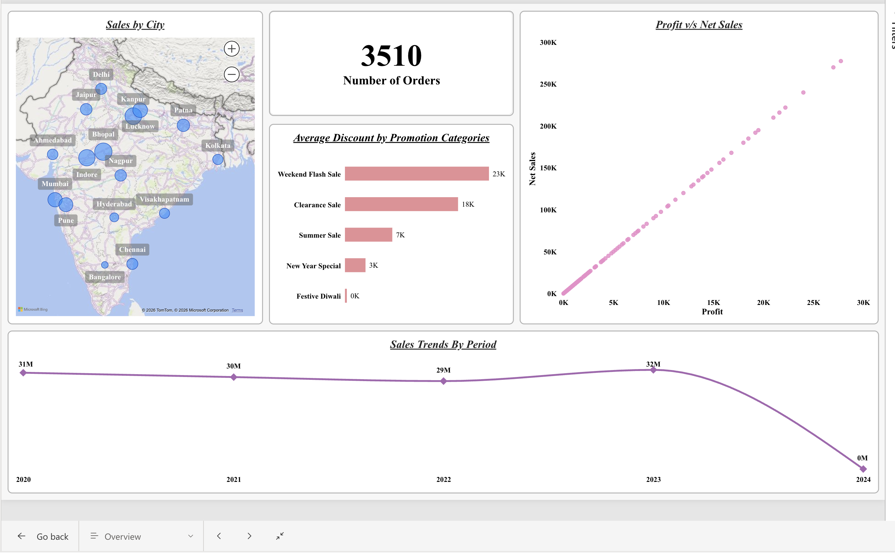

# Retail Sales Analysis – Power BI

## Project Overview
An interactive Power BI dashboard developed to analyse sales performance for an offline retail store dealing in electronics, footwear, clothing, home appliances, accessories, kitchenware, bags, and personal care products.

The project focuses on identifying sales trends, evaluating product performance, analysing discounts, and comparing business performance across different periods.

## Business Objectives
- Identify the top and bottom 5 products by sales, estimated profit, and quantity sold.
- Analyse sales trends across daily, monthly, quarterly, and annual periods.
- Examine the relationship between sales and estimated profit.
- Compare sales, estimated profit, and quantity sold across selected periods.
- Analyse average discounts by promotion category.
- Track total orders and sales performance across cities.
- Provide detailed order-level analysis with interactive filters.

## Tools & Technologies
- Power BI Service
- Power Query
- DAX
- Excel
- Data Modelling – Star Schema

## Data Model
The project uses a star schema consisting of:
- Dim Customers
- Dim Product
- Dim Promotion
- Fact Table

The dimension tables are connected to the fact table using one-to-many relationships with single-direction filtering.

## Key Measures
- Total Sales
- Net Sales
- Estimated Profit
- Total Quantity Sold
- Total Orders
- Average Discount

Profit is calculated using an assumed 10% margin on net sales.

## Dashboard Preview
Screenshots of the dashboard are available in the `screenshots` folder.

## Project Files
- `Sales Data Analysis.pbix` – Power BI report file
- `screenshots/` – Dashboard screenshots

## Disclaimer
This is a personal learning project developed for data analysis and Power BI practice. The 10% profit margin is a project assumption and does not represent actual business profit.

